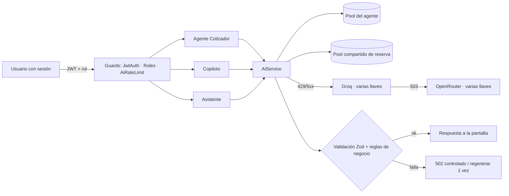

# Arquitectura agéntica segura — Travel OS

Travel OS tiene **tres agentes de IA acotados**. Ninguno es un LLM genérico con permisos amplios: cada uno tiene una sola tarea, recibe solo los datos que necesita, no puede ejecutar acciones y su salida se valida antes de usarse.

| Agente | Endpoint | Pool de llaves | Entrada | Salida validada | Qué no puede hacer |
|---|---|---|---|---|---|
| **Cotizador** (2 pasos: extraer solicitud y proponer alternativas) | `POST /api/quotes` | `GEMINI_API_KEYS_QUOTE` | Texto del asesor (≤ 2.000 caracteres), catálogo de la agencia filtrado por destino, base de conocimiento | `tripRequestSchema`, `alternativesSchema` + verificación de IDs contra el catálogo, sin repetidos y con 1 hotel y ≥ 1 actividad | Inventar productos o precios (los totales los calcula el sistema) |
| **Copiloto** | `GET /api/ai/leads/prioritized` | `GEMINI_API_KEYS_COPILOT` | Etapa, antigüedad y tareas vencidas de los prospectos visibles para el rol (sin correo ni teléfono) | `leadScoresSchema` + mismo conjunto exacto de `leadId` | Puntuar prospectos de otro asesor u otra agencia |
| **Asistente** | `POST /api/ai/assistant` | `GEMINI_API_KEYS_ASSISTANT` | Cifras agregadas según rol, guía de pantallas, base de conocimiento, mensaje (≤ 1.000) e historial (≤ 6 turnos) | `assistantReplySchema`: respuesta ≤ 1.500 caracteres y ≤ 3 enlaces de una lista blanca de rutas internas | Crear, borrar o enviar datos; enlazar fuera de la aplicación |

## Redundancia de llaves

1. **Pool por agente.** `GEMINI_API_KEYS_<AGENTE>` (lista separada por comas) va primero; el pool compartido (`GEMINI_API_KEYS` + `GEMINI_API_KEY`) se añade como reserva, sin duplicados. Si el cotizador agota sus llaves, el asistente y el copiloto siguen con las suyas.
2. **Rotación y enfriamiento.** Cada petición empieza en una llave distinta (round-robin). Una llave que termina en 429 queda 60 s fuera; el enfriamiento es por llave, así que una llave agotada por un agente tampoco se reintenta desde otro.
3. **Cadena de modelos.** Con cada llave se recorre `GEMINI_MODEL` (lista); si todos responden 429 se espera `AI_RETRY_PAUSE_MS` y se intenta una vez más.
4. **Respaldo de proveedor.** Agotado Gemini se pasa a Groq (`GROQ_API_KEYS`) y luego a OpenRouter (`OPENROUTER_API_KEYS`), cada uno con varias llaves. Solo un 503 (cuota o caída) salta de proveedor; un error de formato no.
5. **`AI_PROVIDER`** fija un proveedor y desactiva el respaldo (útil para pruebas). En producción no se define.

## Controles de seguridad

| Riesgo (OWASP LLM Top 10) | Control |
|---|---|
| LLM01 Inyección de prompt | El texto del usuario viaja como JSON (`{"solicitud": ...}`, `{"mensaje": ...}`) y el prompt de sistema ordena tratarlo como datos. Aunque el modelo obedezca una inyección, no tiene herramientas y su salida pasa por esquema y reglas. |
| LLM02 Salida insegura | Zod estricto, longitudes máximas, enlaces solo de una lista blanca, IDs verificados contra la base de datos; React escapa todo el texto. |
| LLM04 Denegación de servicio | `AiRateLimitGuard`: 20 llamadas por usuario y minuto (`AI_RATE_LIMIT_PER_MIN`); tiempo máximo de 45 s por llamada. |
| LLM06 Fuga de información | Cada consulta filtra por `agencyId` y, para el asesor, por `assigneeId`. El copiloto y el asistente no reciben datos de contacto. Las llaves nunca salen del servidor; `/api/ai/status` (solo ADMIN) devuelve conteos. |
| LLM08 Exceso de agencia | Ningún agente tiene herramientas ni puede escribir; el cotizador crea registros solo a través del servicio, con datos ya validados. |
| LLM09 Exceso de confianza | La interfaz avisa que la IA puede equivocarse; precios y totales nunca vienen del modelo. |
| Observabilidad | Registro por llamada sin contenido: `ai_call agent=… outcome=… ms=…`, `ai_key_cooldown agent=… slot=…`, `ai_fallback …`. |

## Pruebas

- `apps/api/src/ai/ai.service.scaling.spec.ts`: rotación, enfriamiento, pool por agente + reserva, enfriamiento compartido, respaldo a OpenRouter, rotación de llaves Groq, `AI_PROVIDER` sin respaldo.
- `apps/api/src/ai/assistant.service.spec.ts`: alcance por rol y agencia, inyección tratada como datos, salida con enlaces externos rechazada.
- `apps/api/src/common/ai-rate-limit.guard.spec.ts`: límite por usuario y ventana de un minuto.
- `apps/api/src/ai/lead-prioritization.service.spec.ts` y `quotes.service.spec.ts`: conjuntos exactos y catálogo.
- Prueba en vivo (`scripts/agents-smoke.mjs`): los tres agentes contra producción, incluidos intentos de inyección.

## Operación

- Cargar llaves: `scripts/set-ai-keys.sh` (las pide sin mostrarlas y las guarda cifradas en Vercel).
- Ver estado: Centro de Agentes → «Estado de la IA» (administrador) o `GET /api/ai/status`.
- Limitación conocida: el enfriamiento y el límite por usuario viven en memoria de cada instancia serverless. Para tráfico alto se mueven a Redis (ya está en `docker-compose`).
