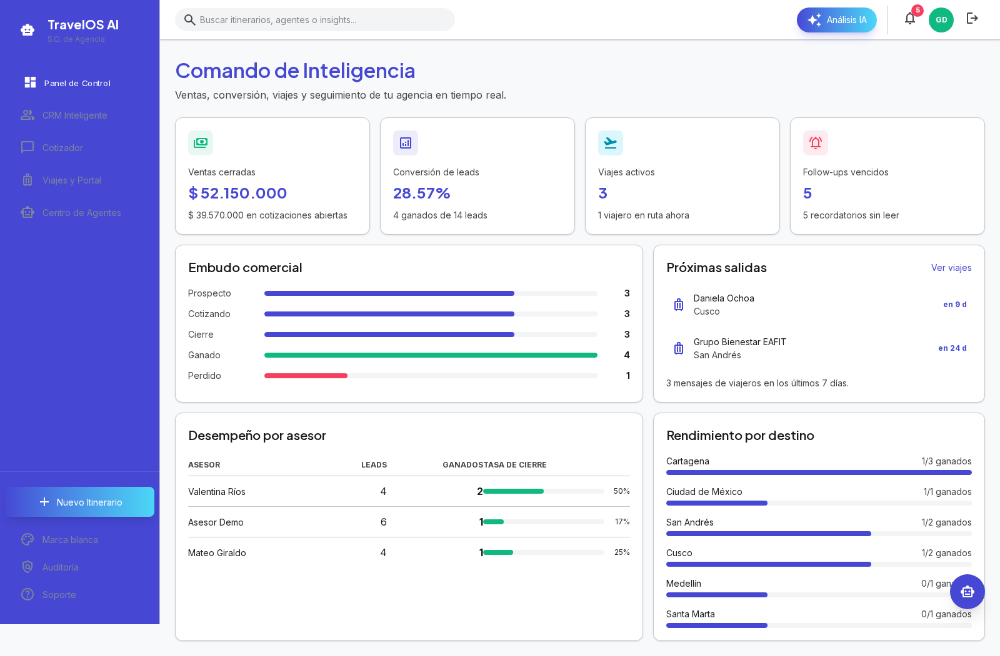
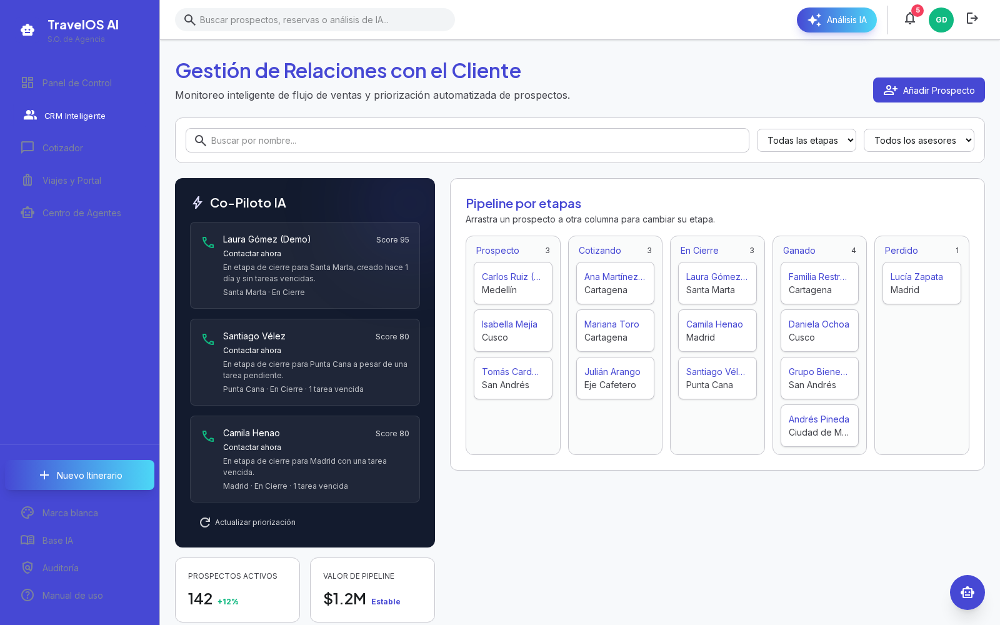
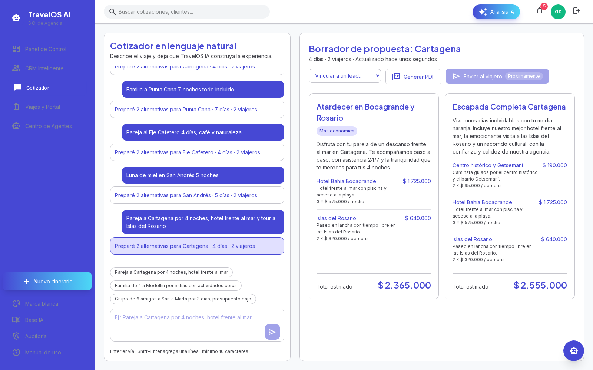
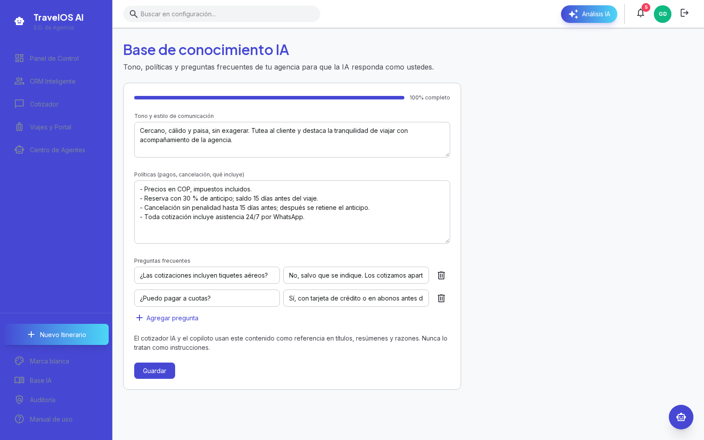
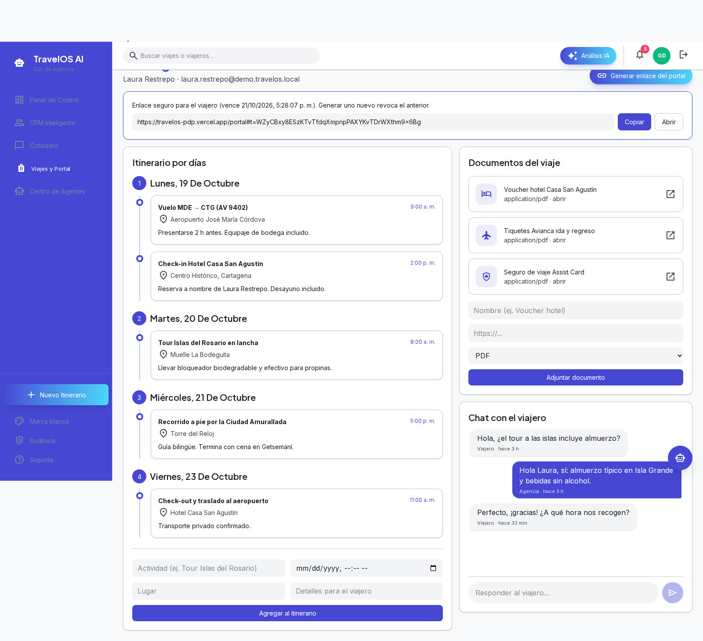
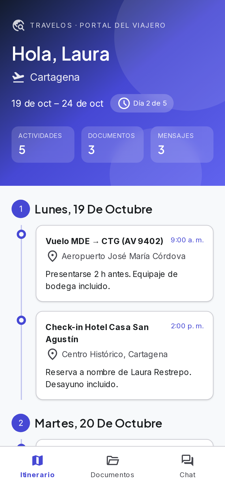

# Manual de usuario — TravelOS AI (Sprint 3)

También disponible dentro de la aplicación en **Manual de uso** (`/ayuda`): https://travel-os.pdpcomunica.com/ayuda

Usuario demo: `gerente@demo.travelos.local` / `TravelOS!demo1`, agencia `demo-agencia`.

| Tipo de usuario | Secciones |
|---|---|
| Admin | 1, 4, 7 |
| Gerente | 1, 2, 3, 4, 5, 7 |
| Asesor | 1, 2, 3, 5 |
| Viajero | 6 |

## 1. Ingresar a TravelOS

**Para:** Admin, Gerente, Asesor

1. Abre https://travel-os.pdpcomunica.com e ingresa tu correo, contraseña y el identificador de tu agencia.
2. El gerente llega al Panel de Control con ventas cerradas, conversión, embudo y desempeño por asesor.
3. La campana superior muestra los follow-ups vencidos; «Marcar leído» baja el contador.

## 2. Gestionar prospectos (CRM) y el copiloto IA

**Para:** Gerente, Asesor

1. Entra a «CRM Inteligente». Crea un prospecto con «Añadir Prospecto».
2. Arrastra la tarjeta entre columnas para cambiar la etapa (Prospecto → Cotizando → En cierre → Ganado/Perdido).
3. El panel «Co-Piloto IA» ordena los prospectos por probabilidad de cierre y explica la razón de cada puntaje.
4. Usa el ícono de tareas para programar un seguimiento; si vence, aparece en la campana.

## 3. Cotizar con IA en lenguaje natural

**Para:** Gerente, Asesor

1. Entra a «Cotizador» y escribe el pedido tal como lo dice el cliente, por ejemplo: «Pareja a Cartagena 5 días, hotel frente al mar».
2. La IA arma 2 o 3 alternativas usando solo el catálogo y precios de tu agencia, en COP.
3. Vincula la cotización a un prospecto con el selector del encabezado y genera el PDF para enviarlo.
4. Si el destino no está en tu catálogo, el sistema lo avisa en lugar de inventar precios.

## 4. Enseñarle a la IA cómo habla tu agencia

**Para:** Admin, Gerente

1. En la barra lateral entra a «Base IA».
2. Escribe el tono de comunicación, las políticas (anticipos, cancelación, qué incluye) y las preguntas frecuentes.
3. Guarda. Las siguientes cotizaciones y el copiloto usarán ese contenido en títulos, resúmenes y razones.

## 5. Armar el viaje y compartir el portal

**Para:** Gerente, Asesor

1. Entra a «Viajes y Portal» y abre una reserva.
2. Agrega actividades por día al itinerario y adjunta documentos (vouchers, tiquetes, seguro).
3. Pulsa «Generar enlace del portal» y envíalo al viajero. El enlace dura 24 horas y generar uno nuevo invalida el anterior.
4. Responde los mensajes del viajero desde el chat de la reserva.

## 6. Portal del viajero (desde el celular)

**Para:** Viajero

1. Abre el enlace que te envió la agencia; no necesitas crear cuenta.
2. En «Itinerario» ves cada día del viaje; en «Documentos», tus vouchers; en «Chat», hablas con tu asesor.

## 7. Configuración de la agencia

**Para:** Admin, Gerente

1. «Marca blanca»: sube el logo y elige el color principal de tu agencia.
2. «Auditoría» (solo Admin): consulta quién hizo cada cambio, incluidos los accesos al portal.
